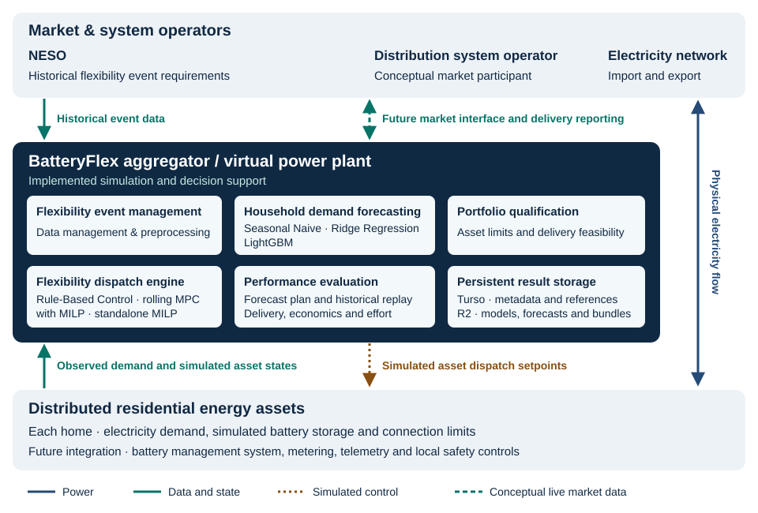
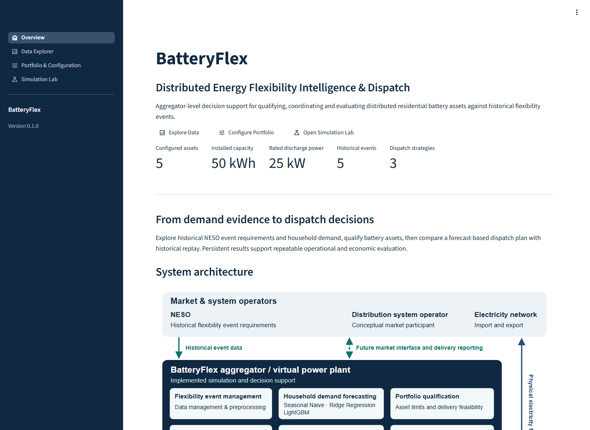
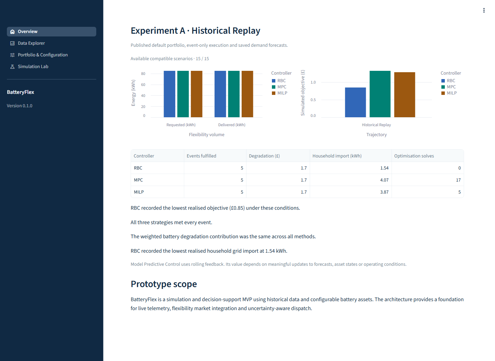

# BatteryFlex

**Distributed Energy Flexibility Intelligence & Dispatch**

BatteryFlex helps a flexibility aggregator assess whether a portfolio of residential batteries can
meet an event obligation, then compare dispatch strategies on delivery, household electricity
costs, battery degradation and computational effort. It is a simulation and decision-support MVP
using historical data and configurable assets.

## Application

| Workspace | Purpose |
| --- | --- |
| Overview | Review the configured portfolio, system architecture and compatible saved Experiment A outcomes. |
| Data Explorer | Inspect original national event requirements, portfolio simulation targets, replay mappings and measured household demand. |
| Portfolio & Configuration | Edit and save battery parameters, review active assets and estimate usable delivery capability. |
| Simulation Lab | Review demand forecasts, run an event or all five events, and compare saved dispatch performance. |



The physical electricity path connects homes directly to the electricity network. BatteryFlex
models demand, asset state and dispatch signals inside the aggregator layer. Live market
interfaces, metering and local execution are shown as future integrations.

## Data and forecasting

- **NESO Demand Flexibility Service.** Five reviewed historical demand-reduction events spanning
  17 half-hours. The source reports national requirements in megawatts. The configurable
  BatteryFlex target uses portfolio kilowatts and kilowatt-hours.
  Supported by National Energy SO Open Data.
  [Current DFS dataset](https://www.neso.energy/data-portal/demand-flexibility) ·
  [2023/24 archive](https://www.neso.energy/data-portal/demand-flexibility-service) ·
  [NESO Open Licence](https://www.neso.energy/data-portal/neso-open-licence)
- **Low Carbon London.** Simon H. Tindemans, *Low Carbon London smart meter data (refactored)*,
  v1, 4TU.ResearchData, based on UK Power Networks observations. The application preserves the
  half-hour-ending GMT timestamps. Each event maps to a 2013 day in the same month and on the
  same weekday for historical replay. Prepared inputs are derived subsets of the source.
  [Dataset and attribution](https://doi.org/10.4121/fbbe775b-48d8-469f-a39b-b64488bfd6fd.v1) ·
  [CC BY 4.0](https://creativecommons.org/licenses/by/4.0/)
- **Demand forecasting.** Seasonal Naive provides a reference for Ridge Regression and LightGBM.
  Forecasts span 48 half-hours with pre-origin training inputs. Saved artifacts support
  household and portfolio MAE and RMSE checks alongside forecast versus measured demand.
  [Forecasting protocol](docs/TASK05D_EVENT_FORECASTING.md)

## Portfolio and dispatch strategies

The standard scenario uses five simulated 10 kWh batteries with 5 kW rated discharge each.
Portfolio qualification checks forecast-based feasibility and asset constraints. After
qualification, the dispatch engine runs one of three strategies.

| Strategy | Dispatch decisions |
| --- | --- |
| Rule-Based Control (RBC) | Deterministic operating rules allocate dispatch according to available battery capability. |
| Model Predictive Control (MPC) | Rolling Mixed-Integer Linear Programming (MILP) solves update dispatch decisions at half-hour boundaries using modelled battery states. Each solve applies its first action. |
| Standalone MILP | One multi-period solve plans the whole event. Historical replay applies the saved schedule subject to physical and connection limits. |

Experiment A runs only during each event with synthetic event-start states of charge. All
controllers use the same portfolio, forecasts, 10 kW half-hour obligation, tariffs, reserve
constraints and objective weights. Historical Replay uses observed demand for execution checks
and scoring according to the existing replay protocol. The objective combines electricity cost,
a model shortfall penalty, battery degradation cost and a soft terminal state-of-charge penalty.

## Verified Experiment A benchmark

| Controller | Events met | Requested / delivered | Forecast plan objective | Replay objective | Replay solves |
| --- | ---: | ---: | ---: | ---: | ---: |
| RBC | 5/5 | 85 / 85 kWh | £0.5513 | £0.8458 | 0 |
| MPC | 5/5 | 85 / 85 kWh | £0.4925 | £1.3228 | 17 |
| Standalone MILP | 5/5 | 85 / 85 kWh | £0.4925 | £1.2825 | 5 shared solves |

The five-event replay favoured RBC on weighted objective under these settings. All three
methods met the obligation and incurred £1.70 in weighted battery degradation cost. RBC's
more distributed allocation served more demand behind the meter. This reduced realised
household grid import to 1.54 kWh, compared with 4.07 kWh for MPC and 3.87 kWh for standalone
MILP. Demand forecast differences changed how forecast-optimal allocations translated into
realised imports. Multiple schedules can have the same forecast objective, and rolling
optimisation sometimes selected alternative actions as the horizon moved. MPC's value
depends on meaningful updates to operating conditions, forecasts or asset states.
[Verified results and methods](docs/TASK06_BATCH_VERIFICATION.md)

## Screenshots





## Software and storage

The Streamlit shell uses domain modules for event and demand data, battery qualification,
dispatch and evaluation. Turso holds metadata, indexes and content references. Cloudflare R2
holds content-addressed data, models, forecasts and numerical run bundles. SQLite and a
local object directory support isolated development and testing. Exact scenario fingerprints
preserve effective numerical settings and input provenance. Single and batch dispatch
reuse verified saved records before doing any new work.

- [Configuration and defaults](config/README.md)
- [Storage and explicit provisioning](docs/STORAGE.md)
- [Product refinement and verification](docs/PRODUCT_REFINEMENT.md)

## Install and run

The project requires Python 3.12 or later. The refinement was verified with Python 3.12.10,
Streamlit 1.67.0 and SciPy 1.18.1. Run from the repository root.

```powershell
py -3.12 -m venv .venv
.\.venv\Scripts\python.exe -m pip install -e ".[dev]"
.\.venv\Scripts\python.exe -m streamlit run app.py
```

Overview, the historical event registry and the default portfolio open without storage
credentials. To reproduce the experiment in an empty local store, explicitly prepare the
2013 source data, bootstrap storage, publish the history and request event forecast models.

```powershell
$env:BATTERYFLEX_STORAGE_MODE = "local"
$env:BATTERYFLEX_ACCESS_MODE = "owner"
.\.venv\Scripts\python.exe scripts/prepare_lcl.py --acquire
.\.venv\Scripts\python.exe scripts/storage_admin.py bootstrap --local
.\.venv\Scripts\python.exe scripts/prepare_event_history.py
.\.venv\Scripts\python.exe scripts/run_event_forecasts.py --history data/lcl/event_history_v1
.\.venv\Scripts\python.exe -m streamlit run app.py
```

In **Simulation Lab → Dispatch Simulation**, select **Run All Five Events** for each
strategy. Compare them under **Dispatch Performance & Evaluation → All Five Events →
Historical Replay**. Use compatible saved artifacts and the verified solver version
for close numerical reproduction. Solver times depend on the machine, and equal forecast
objectives can yield different optimal schedules across solver versions.

For dedicated cloud storage, copy the placeholders from [.env.example](.env.example) to
a private environment file and follow the [storage instructions](docs/STORAGE.md).
Keep local databases, raw and prepared data, generated artifacts and credentials out of
the publication set.

## Streamlit Community Cloud

Deploy the private repository from `main` with `app.py`, Python 3.12, and the
read-only demonstration settings. The same saved Turso and Cloudflare R2
artifacts support the demonstration. Use a separate authorised owner instance
for training, execution and saved portfolio changes.
[Deployment settings, secrets and verification checklist](docs/STREAMLIT_DEPLOYMENT.md)

## Verification

The type check uses the optional development tool `ty` (0.0.104 in this review).
Install it with `python -m pip install ty` when running that check in a fresh environment.

```powershell
.\.venv\Scripts\python.exe -m pytest -q
.\.venv\Scripts\python.exe -m ruff check .
.\.venv\Scripts\python.exe -m ruff format --check .
.\.venv\Scripts\ty.exe check src scripts app.py
```

## Current scope

The comparison covers five historical events, synthetic battery configurations and the
specified demand mapping and forecast policy. Costs and delivery are simulation outputs.
Live telemetry, market interfaces, settlement and uncertainty-aware dispatch are future
integration areas. A hosted write-enabled instance requires controlled access to dispatch,
forecast training and shared portfolio updates.
